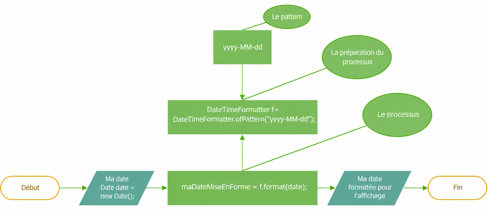
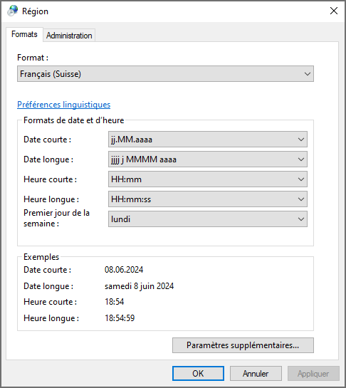

# Théorie formatage des dates

Le principe est le même que pour le formatage des nombres, avec un processus de conversion qui cette fois repose sur la classe
**DateTimeFormatter** du package **java.time**.





L'équivalent en code:

## Formatage simple avec la Locale par défaut :
```java

// Définition d'une date locale
LocalDate date = LocalDate.now();

// Préparation de notre outil de transformation avec DateTimeFormatter
DateTimeFormatter formatter = DateTimeFormatter.ofPattern("yyyy-MM-dd");

// Transformation et récupération du résultat
String laDateMiseEnForme = date.format(formatter);

// Affichage du résultat, par exemple : "2024-05-30"
System.out.println(laDateMiseEnForme);

```

## Les patterns utilisables

| Pattern              | Explication                                                            | Exemple d'entrée | Exemple de sortie   |
|----------------------|------------------------------------------------------------------------|------------------|---------------------|
| `yyyy-MM-dd`         | <b>Le plus commun pour les dates</b><br>Année avec quatre chiffres, mois sur deux chiffres, jour sur deux chiffres | 2024-06-25       | 2024-06-25          |
| `EEE, MMM d, ''yy`   | Jour de la semaine abrégé, mois abrégé, jour du mois sans zéro initial, année sur deux chiffres | Sam, juin 8, '24  | Sat, Jun 8, '24     |
| `h:mm a`             | Heure sur 12 heures, minutes sur deux chiffres, AM/PM                  | 5:30 PM          | 5:30 PM             |
| `HH:mm:ss`           | <b>Le plus commun pour les heures</b><br>Heure sur 24 heures, minutes sur deux chiffres, secondes sur deux chiffres | 17:30:00         | 17:30:00            |
| `hh 'o''clock' a, z` | Heure sur 12 heures, texte 'o'clock', AM/PM, timezone                  | 5 o'clock PM, EST| 5 o'clock PM, EST   |
| `yyyy.MM.dd G 'at' HH:mm:ss z` | Année avec quatre chiffres, mois sur deux chiffres, jour sur deux chiffres, ère, heure sur 24 heures, minutes, secondes, timezone | 2024.06.08 AD at 17:30:00 PST | 2024.06.08 AD at 17:30:00 PST |
| `EEEE, MMMM d, yyyy` | Jour de la semaine complet, mois complet, jour du mois sans zéro initial, année avec quatre chiffres | Samedi, Juin 8, 2024 | Saturday, June 8, 2024 |

### Légende :
- `y` : Année.
- `M` : Mois.
- `d` : Jour.
- `H` : Heure de la journée (0-23).
- `h` : Heure en format AM/PM (1-12).
- `m` : Minutes.
- `s` : Secondes.
- `S` : Millisecondes.
- `E` : Jour de la semaine abrégé
- `EEEE` : Jour de la semaine dans la langue locale
- `M` : Mois en nombre
- `MMMM` : Mois dans la langue locale
- `D` : Jour de l'année.
- `F` : Jour de la semaine dans le mois.
- `w` : Semaine de l'année.
- `W` : Semaine du mois.
- `a` : AM/PM.
- `z` : Fuseau horaire général.


## Formatage avancé, avec utilisation de Locales

Comme vous l'avez remarqué dans le tableau ci-dessus, la Locale par défaut est utilisée pour formater les dates et heures. En réalité, cela impacte principalement le nom du jour, du mois, et le numéro de jour de la semaine.

Dans certaines situations, il peut être nécessaire de changer la Locale par défaut afin d'obtenir un affichage adapté à un pays ou une langue spécifique.

Pour cela, `DateTimeFormatter` permet d'utiliser directement une locale lors de la création du formateur.

```java
// Définition d'une Locale spécifique (par exemple, la Suisse romande)
Locale locale = new Locale.Builder().setLanguage("fr").setRegion("CH").build();

// Création d'une date à formater (date actuelle)
LocalDate date = LocalDate.now();

// Création d'un formateur avec le pattern et la locale personnalisée
DateTimeFormatter formatter = DateTimeFormatter.ofPattern("EEEE, MMMM dd, yyyy", locale);

// Formatage de la date selon le pattern et la locale
String formattedDate = formatter.format(date);

// Affichage du résultat formaté : par exemple "samedi, juin 08, 2024"
System.out.println("Date formatée (Suisse personnalisé): " + formattedDate);
```

### DateTimeFormatter, LocalDate et LocalDateTime

Une fonctionnalité importante est la prise en compte du format d'affichage de la Locale de l'utilisateur. En effet cela vous permettra de créer des logiciels avec le format d'affichage correspondant à la Locale par défaut de l'utilisateur. 
Voici un exemple simple illustrant cela:

```java

LocalDate date = LocalDate.now()
                          .plusDays(5)
                          .minusMonths(1)
                          .withYear(2025);

// Création d'un formateur de date avec le style court et la locale par défaut
DateTimeFormatter formatter = DateTimeFormatter.ofLocalizedDate(FormatStyle.SHORT).withLocale(Locale.getDefault());                                   

// Formatage de la date
String formattedDate = date.format(formatter);

// Affichage de la date formatée: affichera 13.05.25, selon les paramètres d'environnement du format régional (LOCALE)
System.out.println(formattedDate);

```

Le format de style court fait référence à ce paramètrage Windows :



#### Voici encore des exemples de la puissance de ce package :

Et si on voulait **calculer le nombre de jours et le nombre d'heures séparant deux dates précises** (en tenant compte des années bissextiles, des mois à 30 jours, ...) :
```java
// Instant N°1 : 1er janvier 2024 à 08:00
LocalDateTime dateTime1 = LocalDateTime.of(2024, 01, 1, 8, 0);
// Instant N°2 : 15 juillet 2024 à 11:45
LocalDateTime dateTime2 = LocalDateTime.of(2024, 7, 15, 11, 45);

// Jours écoulés entre 1 et 2
long days = dateTime1.until(dateTime2, ChronoUnit.DAYS);
System.out.println("Jours entre ces deux dates/heures : " + days);

// Heures écoulées entre 1 et 2, de deux façons différentes
long hours = dateTime1.until(dateTime2, ChronoUnit.HOURS);
System.out.println("Heures entre ces deux instants : " + hours);

long hours2 = Duration.between(dateTime1, dateTime2).toHours();
System.out.println("Heures entre ces deux instants : " + hours2);
```
ce qui produira ceci sur la console :
```text
Jours entre ces deux dates/heures : 196
Heures entre ces deux instants : 4707
Heures entre ces deux instants : 4707
```

Et si on voulait déterminer **la date d'aujourd'hui + 5 jours et - 1 mois + 7542 minutes avec l'année fixée à 2025** !?!?  
Fastoche :
```java
// Créer une date à partir d'un calcul complexe partant d'aujourd'hui
LocalDateTime date = LocalDateTime.now().plusDays(5).minusMonths(1).plusMinutes(7542).withYear(2025);
```

Et si on voulait calculer **la date de maintenant() + 1 jour + 24x60 minutes (=1 jour aussi) - 1 mois avec l'année fixée à 1968** !?!?

```java
// Calcul de maintenant() + 1 jour + 24x60 minutes (=1 jour aussi) - 1 mois
// en fixant l'année à 1968
LocalDateTime computedDate = LocalDateTime.now().plusDays(1).minusMonths(1).plusMinutes(60 * 24).withYear(1968);
DateTimeFormatter dtf = DateTimeFormatter.ofPattern("dd-MM-yyyy HH:mm");
System.out.println(dtf.format(computedDate));
```
ce qui produira ceci sur la console :
```text
24-07-1968 13:55
```

Et on peut faire encore un tas d'autres choses. Voici quelque ressources pour aller plus loin :
- [DateTimeFormatter](https://docs.oracle.com/en/java/javase/17/docs/api/java.base/java/time/format/DateTimeFormatter.html)
- [LocalDate](https://docs.oracle.com/en/java/javase/17/docs/api/java.base/java/time/LocalDate.html)
- [LocalDateTime](https://docs.oracle.com/en/java/javase/17/docs/api/java.base/java/time/LocalDateTime.html)


