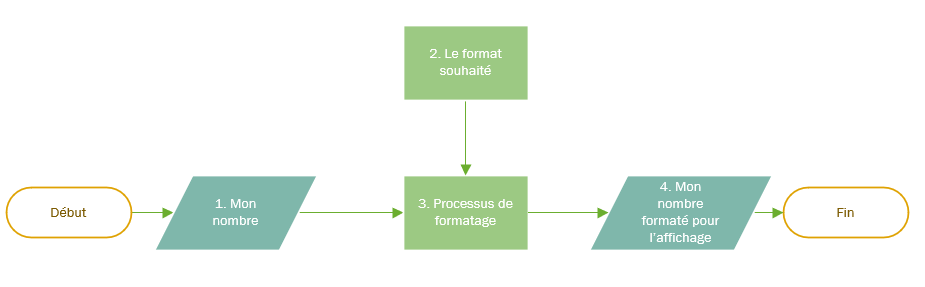
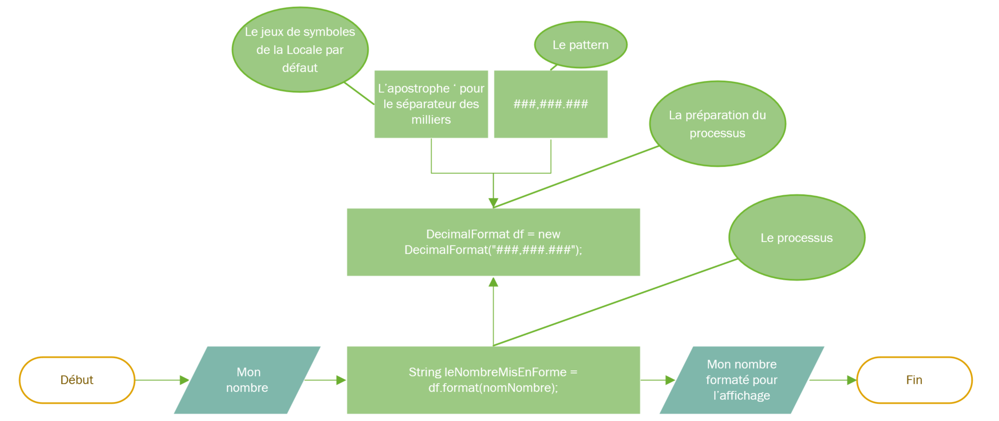

# Théorie formatage des nombres

La classe DecimalFormat en Java est utilisée pour formater les nombres selon un certain modèle de formatage. Elle fait partie du package **java.text** et permet de personnaliser l'affichage des nombres en fonction de besoins spécifiques, comme l'ajout de séparateurs de milliers, le contrôle du nombre de chiffres après la virgule, ou encore le préfixe/suffixe des valeurs.

Sans connaître le fonctionnement de cette classe, on peut imaginer qu'elle mettra en relation les éléments suivants:
1. Votre nombre
2. Le format d'affichage souhaité
3. Un processus de conversion
4. Le résultat à afficher

  



## Un mot sur le concept de "Locale"
Le concept de "locale" fait référence à une région géographique, une langue.
Lors du formatage des nombres, la localisation (ou "locale" en anglais) joue un rôle crucial car elle détermine les conventions spécifiques utilisées pour le formatage, tels que le séparateur décimal, le séparateur de milliers, et même les symboles monétaires.
La classe Locale dans le package java.util permet de représenter et de manipuler ces informations.

Depuis le JDK 9, Java utilise le CLDR (Common Locale Data Repository) pour les Locales et leurs symboles. Dans un système Windows configuré en français suisse, Java choisira donc par défaut la locale fr_CH du CLDR.

Dans le JDK 17, la locale de_CH utilise un point pour séparer les décimales et un apostrophe pour séparer les groupes (milliers). La locale fr_CH utilise une virgule pour séparer les décimales et un petit espace insécable pour séparer les groupes. Ce caractère unicode n'est pas toujours bien rendu par la console Windows.

## Formatage simple avec la Locale par défaut :

Un constructeur de la classe DecimalFormat va nous permettre de créer notre outil de conversion, en indiquant directement en paramètre le pattern d'affichage souhaité.
L'objet retourné de type DecimalFormat servira à effectuer la transformation de notre nombre.

**Attention:** Avec ce constructeur ce sont les **symboles** de la Locale par défaut qui sont utilisés.

Il ne faut pas confondre pattern et symbole:
   - la virgule (,) du pattern définit la présence et l'emplacement de séparateurs
   - dans l'affichage, un espace ou une apostrophe (ou autre) sera utilisé pour représenter ce séparateur

Voici la même explication en code:

- public DecimalFormat(String pattern)

 ```java
//Début du processus et définition d'un nombre.
double monNombre = 1234567.89569;

/*Préparation de notre outil de transformation en utilisant un des constructeurs de DecimalFormat, avec en paramètre le pattern désiré.
L'objet retourné de type DecimalFormat va nous permettre d'effectuer la transformation de notre nombre: */
DecimalFormat df = new DecimalFormat("###,###.###");

//Transformation et récupération du résultat
String leNombreMisEnForme = df.format(monNombre);

//Affichage du résultat (peut varier selon la locale) :  1'234'567.895;
System.out.println(leNombreMisEnForme); 
```

Et l'illustration schématique:



### Aperçu des patterns utilisables

| Pattern              | Explication                                                            | Exemple d'entrée | Exemple de sortie   |
|----------------------|------------------------------------------------------------------------|------------------|---------------------|
| `###,###.###`        | Séparateur de milliers et jusqu'à trois décimales                     | 12345.678        | 12'345.678          |
| `000000.00`          | Au moins six chiffres avant et deux après le point décimal, remplis de zéros | 78.5             | 000078.50           |
| `#.#`                | Jusqu'à une décimale, pas de séparateur de milliers                   | 12345.678        | 12345.7             |
| `###,###`            | Séparateur de milliers, pas de décimales                              | 1234567.89       | 1'234'568           |
| `###,###.000`        | Séparateur de milliers et exactement trois décimales                  | 1234567.89       | 1'234'567.890       |
| `00000000`           | Au moins huit chiffres, remplis de zéros, pas de décimales            | 12345            | 00012345            |
| `¤ ###,###.00`       | Symbole de devise, séparateur de milliers et exactement deux décimales | 12345.678        | $ 12'345.68         |
| `00.###E0`           | Notation exponentielle avec jusqu'à trois décimales                   | 12345.678        | 12.346E5            |
| `#,##0.0%`           | Multiplie par 100 et ajoute un symbole de pourcentage                 | 0.756            | 75.6%               |
| `0.00‰`              | Multiplie par 1000 et ajoute un symbole pour mille                    | 0.1234           | 123.40‰             |
| `# ?/?`              | Format de fraction simplifiée                                         | 1.25             | 1 1/4               |

### Légende :
- `#` : Un chiffre, affiché seulement s'il est significatif.
- `0` : Un chiffre, affiché même s'il est non significatif.
- `.` : Emplacement du séparateur décimal.
- `,` : Emplacement du séparateur de groupement.
- `¤` : Symbole de la devise.
- `%` : Multiplie par 100 et affiche un symbole de pourcentage.
- `‰` : Multiplie par 1000 et affiche un symbole pour mille.
- `E` : Notation exponentielle/scientifique.
- `?/?` : Fraction simplifiée.


## Formatage avancé, avec utilisation de DecimalFormatSymbols et des Locales

Dans certaines situations, il peut être nécessaire de changer la Locale par défaut et également de changer certains symboles de la Locale utilisée.

Pour cela DecimalFormat propose un autre constructeur qui demande en paramètre le pattern et un jeu de symboles.
Ce jeu de symboles s'obtient avec une instance de **DecimalFormatSymbols**, dont le constructeur lui-même accepte soit aucun argument (c'est la Locale par défaut qui sera utilisée), soit un argument de type Locale.

```java
//Définition d'une Locale spécifique (par exemple, les USA)
Locale locale = Locale.US;
//Instantiation de DecimalFormatSymbols en fonction de cette locale
DecimalFormatSymbols decimalFormatSymbols = new DecimalFormatSymbols(locale);

//Instantiation de DecimalFormat, avec un pattern et un jeu de symbols correspondant à la locale.
DecimalFormat df = new DecimalFormat("¤ #,##0.00", decimalFormatSymbols);

// Transformation et récupération du résultat
String leNombreMisEnForme = df.format(monNombre);

// Affichage du résultat: $ 1,234,567.90 
System.out.println(leNombreMisEnForme);
```

On peut également redéfinir certains symboles sans forcément modifier la Locale.

```java
double monNombre = 1234567.89569;
//Création d'un jeu de symboles par défaut
DecimalFormatSymbols symbols = new DecimalFormatSymbols();
//Modification du séparateur des groupement
symbols.setGroupingSeparator('\''); 
//Modification du séparateur de décimales
symbols.setDecimalSeparator('.');
//Formatage et affichage du nombre
DecimalFormat df = new DecimalFormat("###,###.##", symbols);
String leNombreMisEnForme = df.format(monNombre);
System.out.println("Le nombre formaté: " + leNombreMisEnForme); 
//affichera "Le nombre formaté: 1'234'567.89"
```


